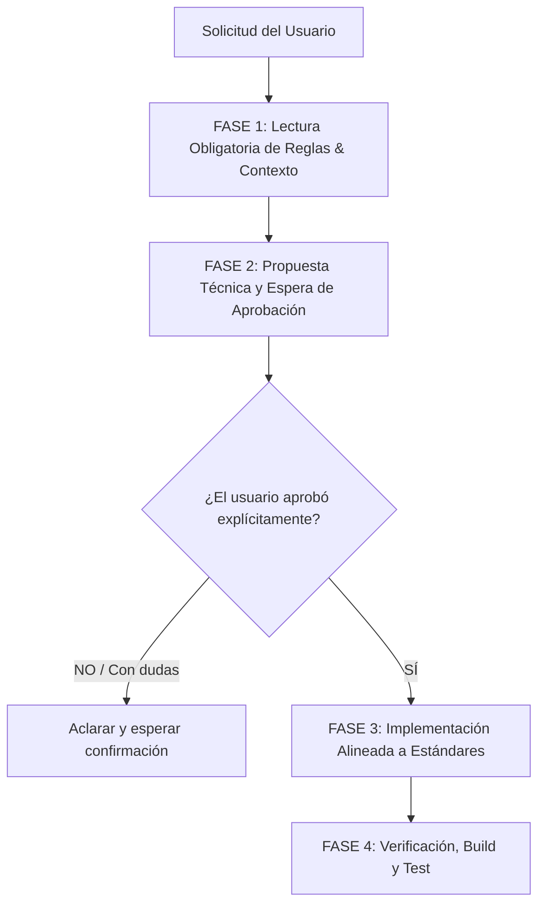

# Protocolo Obligatorio de Cambio y Desarrollo — Sistema aFull

> **REGLA DE ORO:** Este sistema es de grado de producción industrial y ha escalado significativamente.  
> **QUEDA ESTRICTAMENTE PROHIBIDO:** Modificar código o meter cambios "de repente" sin antes haber completado las Fases 1 y 2.

---

## El Flujo de 4 Fases Obligatorias

Toda solicitud del usuario que implique agregar, modificar, eliminar o rediseñar cualquier parte del sistema debe pasar obligatoriamente por este embudo:

---

## FASE 1: Lectura Obligatoria de Reglas & Contexto (Antes de Tocar Código)

Antes de abrir o editar cualquier archivo, el agente **SIEMPRE DEBE**:

1. **Consultar `.agents/AGENTS.md`:**
   - Revisar la sección **3. Matriz de Restricciones (ALWAYS / ASK / NEVER)**.
   - Revisar las **Lecciones Aprendidas (Sección 6 e I)** para no repetir errores históricos (ej: no usar `.toLowerCase()` en nulos, no meter `alert()` nativo, no usar `new PrismaClient()` duplicado, no romper bundles de esbuild).

2. **Consultar `.agents/skills/afull-enterprise-design/SKILL.md` (si el cambio toca UI):**
   - Paleta de colores estricta: `#090a0f`, `#111318`, `#ea580c`.
   - **Zero Blue Policy:** Cero azules en controles, badges o focus rings.
   - Radios de borde estrictos: 4px a 6px (`rounded-md` / `rounded`).
   - Sin estéticas infantiles o burbujas lúdicas (`rounded-3xl` prohibido).

3. **Verificar dependencias e impacto colateral:**
   - ¿Afecta tipos en `src/types.ts`?
   - ¿Afecta contratos de API en `src/server/`?
   - ¿Toca submódulos prohibidos como `ECC`? (NUNCA tocar `ECC`).

---

## FASE 2: Propuesta Técnica y Espera de Aprobación

El agente **NUNCA debe modificar archivos inmediatamente**. Debe presentar primero al usuario:

1. **Diagnóstico del problema o necesidad:** Qué se va a resolver y por qué.
2. **Archivos exactos a intervenir:** Lista concisa de rutas.
3. **Plan de solución:** Breve descripción técnica de los cambios.
4. **Punto de decisión explícito:** Preguntar al usuario: *"¿Estás de acuerdo con este plan para proceder con la implementación?"* y **detenerse** hasta recibir su aprobación.

---

## FASE 3: Implementación con Estándares Rigurosos

Una vez obtenida la confirmación:

1. **Principio Minimalista (PonyTail):**
   - Escribir el mínimo diff posible. No reescribir componentes enteros si basta un cambio puntual.
   - Reutilizar utilidades y componentes ya existentes (`useNotif`, `useSortAndPaginate`, `DataCard`, etc.).
2. **Seguridad y Robustez:**
   - Usar `authFetchJSON` y mantener protección CSRF / cookies httpOnly.
   - Safe navigation obligatoria (`item?.prop?.toLowerCase()`).
   - Manejo de errores con `showToast` de `NotifContext`, nunca `alert()` o `confirm()` nativos.
3. **Preservación de Estado:**
   - En formularios o inputs, nunca borrar datos ingresados por el usuario si la API falla.

---

## FASE 4: Verificación Obligatoria Antes de Confirmar

Antes de cantar victoria o hacer push:

1. **Ejecutar `npm run build`:**
   - Garantizar que Prisma Client, Vite y esbuild compilen con código de salida 0.
2. **Si hay tests afectados, correr Vitest/Playwright:**
   - Asegurar que no se hayan roto flujos existentes.
3. **Revisión de Git (`git status`):**
   - Asegurarse de que no queden archivos basura, logs temporales ni cambios colaterales accidentales.
4. **Pedir autorización antes de `git push` a producción.**
